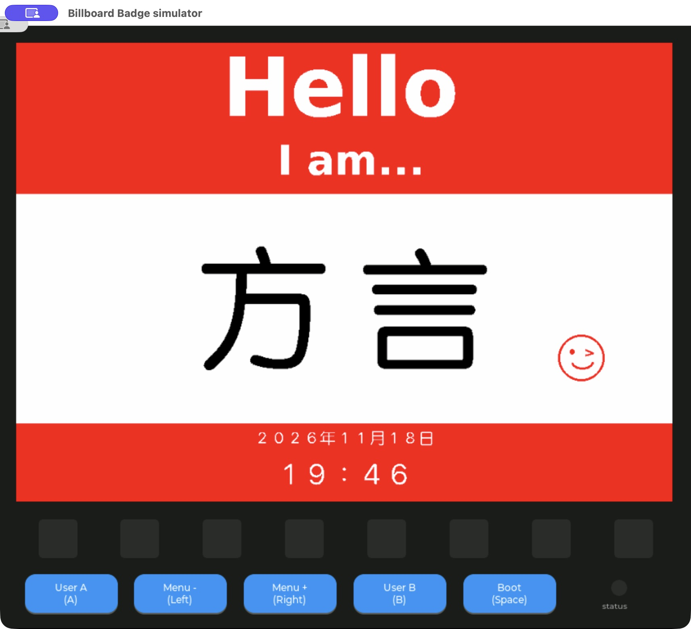

# 给方言的姓名牌

基于 [Hackaday Supercon 2026 Billboard Badge](https://github.com/Hack-a-Day/2026-Billboard_Badge) 的个性化姓名牌应用，显示姓名、表情、日期和时间，并支持按键灯效。

## 操作方式

- **A 键**：循环切换微笑、困困和眨眼表情。
- **B 键**：播放灯光暗号，暖色灯点往返后白灯闪烁三次，随后熄灭。
- **菜单键**：使用原固件的应用切换功能。

日期和时间显示在底部，精确到分钟。表情切换和时间更新使用墨水屏彩色刷新，需要等待画面完成更新。

## 安装

适用于已安装兼容原项目固件的 Billboard Badge，并非完整固件。

1. 备份设备中的 `apps/nametag.py`。
2. 将本仓库的 `apps`、`data` 目录中的文件复制到设备对应目录。
3. 重启设备，选择 **Nametag** 应用。
4. 将设备时钟校准为北京时间；应用不包含联网校时功能。

## 文件说明

- `apps/nametag.py`：姓名牌应用代码。
- `data/`：姓名、表情、日期及时间字形位图。
- `姓名牌模拟器截图.png`：Mac 模拟器运行截图。
